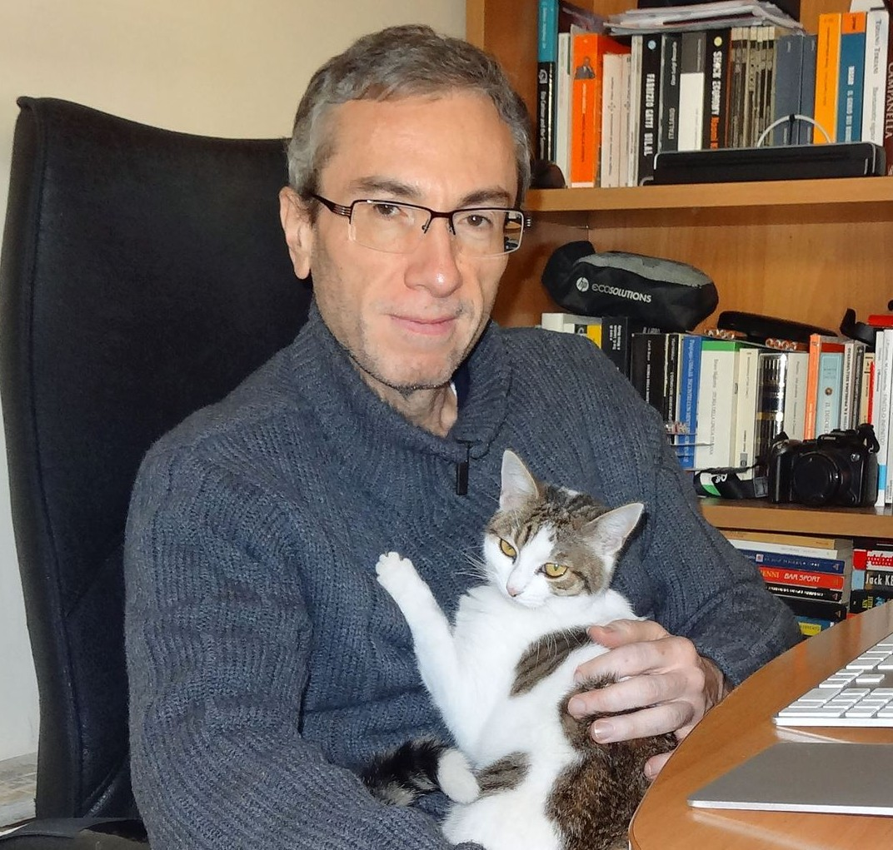

+++ 
title = "Michele Diodati" 
date = "2026-07-24" 
draft = false 
bookHidden = true
+++

## Due parole sull'autore

Mi occupo di divulgazione scientifica dal 2009. Ho collaborato per vari anni con la rivista [Coelum Astronomia](https://www.coelum.com/) e scritto oltre [mille articoli](https://medium.com/@md64) sulla piattaforma Medium, principalmente su temi di astronomia, astrofisica e matematica. *Le stelle più affascinanti del cielo* è il mio ultimo progetto.